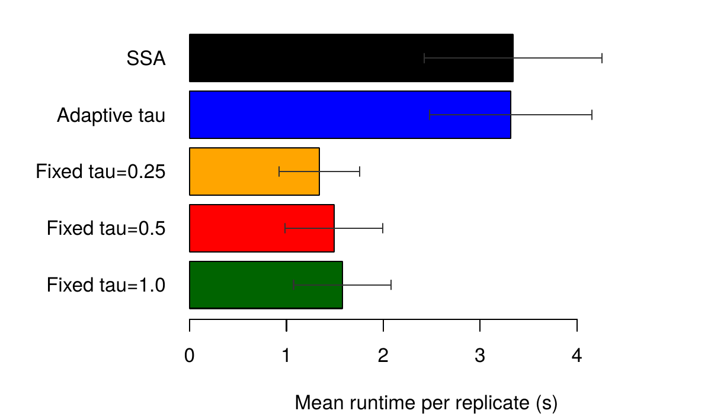
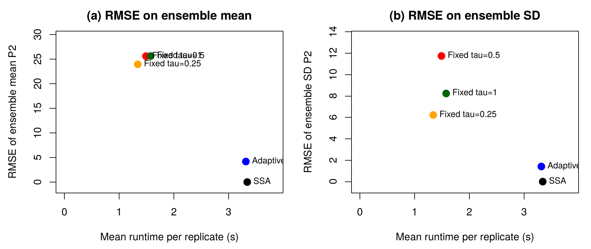

# Stochastic Simulation of an Auto-Regulatory Gene Network

Supplementary code for my BSc dissertation (Durham University, Mathematics and Statistics). Compares the Gillespie SSA, fixed τ-leaping and adaptive τ-leaping on an auto-regulatory gene network, using 1,000 matched-seed replicates, paired bootstrap confidence intervals and distribution-level tests.

**Key finding:** Fixed-step τ-leaping was about 2x faster than the exact SSA but roughly 6x less accurate (RMSE of mean P2), and triggered the numerical safeguard about 16,000 times per run on average. Adaptive τ-leaping matched SSA runtime on this model with roughly 6x lower RMSE than the fixed-step variants.




R code and processed results for the N=1000 benchmark and the chapter 5
figures (auto-regulatory gene network, SSA vs adaptive tau-leaping vs
safeguarded fixed-step tau-leaping).

## Folders

- `scripts/` - R and Python scripts.
- `outputs/` - CSV outputs from the benchmark and the pilot, plus
  `run_metadata_N1000_v3.csv` for the R / package versions and seeds.
- `figures/` - PDF figures used in chapter 5.
- `docs/` - `sessionInfo.txt` from `session_info.R`.

## Requirements

- R 4.5.2 (or close)
- R packages: `smfsb` 1.5, `adaptivetau` 2.3.2
- `parallel` (comes with R) for `detectCores()`
- Python 3 with only the standard library, for `paired_stats.py`

Plots use base R only.

## How to run

Run everything from the repo root.

1. Full benchmark (slow, takes a few hours):

   ```
   Rscript scripts/benchmark_N1000_final.R
   ```

   This writes per-method `partial_*.rds` first and then merges them into
   the CSV files in `outputs/`. The partials are kept on disk after the
   merge so that `chapter5_postprocess.R` can run the matched-seed
   across-replicate paired bootstrap on the per-method P2 matrices (see
   step 7).

   A smoke-test entry point is provided for checking the pipeline without
   overwriting the archived N=1000 outputs. Pass `N_rep` and a separate
   output directory:

   ```
   Rscript scripts/benchmark_N1000_final.R 2 outputs_test
   ```

   The smoke run writes `benchmark_summary_N2.csv` and related files into
   `outputs_test/`; nothing in `outputs/` or `figures/` is overwritten.

2. Figures (only reads the CSV, no need to re-simulate):

   ```
   Rscript scripts/make_chapter5_figures.R
   ```

3. Session info:

   ```
   Rscript scripts/session_info.R
   ```

4. Reference tau-leap demo (one replicate, just for the plot):

   ```
   Rscript scripts/fixed_tau_safeguarded.R
   ```

5. Pilot sweep for appendix A.5 (rrc in 0.05, 0.10, 0.15, 0.20):

   ```
   Rscript scripts/pilot_sweep.R           # default N_pilot = 100
   Rscript scripts/pilot_sweep.R --N=1000  # full size
   ```

6. Paired runtime / safeguard statistics for the chapter 5 narrative:

   ```
   python scripts/paired_stats.py
   ```

7. Across-replicate paired bootstrap on the chapter 5 RMSE summaries
   (needs the `partial_*.rds` files from step 1):

   ```
   Rscript scripts/chapter5_postprocess.R
   ```

   Writes `outputs/chapter5_summary_with_bootstrap_N1000.csv`. The CIs in
   that file are the matched-seed across-replicate paired bootstrap (B =
   1000) and feed straight into the Table 5.2 row block in chapter 5.

8. One-off SSA realisation for the chapter 3 motivating figure:

   ```
   Rscript scripts/make_sample_trajectory.R
   ```

9. Terminal-time ECDF and KS distance check (chapter 5 distribution-level
   comparison; reads the same `partial_*.rds` files as step 7):

   ```
   Rscript scripts/make_terminal_ecdf.R
   ```

   Writes `figures/fig_terminal_ecdf.pdf` and
   `outputs/ks_terminal_N1000.csv`.

## Notes

- All methods share the same per-replicate seed vector
  (`master_seed = 42L`, `seeds = sample.int(.Machine$integer.max, N_rep)`)
  so runtime and accuracy are paired across methods.
- The benchmark sets BLAS to single-thread before loading the packages
  (`OMP`, `MKL`, `OPENBLAS`, `VECLIB` set to 1) so timing comparisons are
  not biased by multi-threaded BLAS variability.
- The benchmark loop inserts a 5-minute `Sys.sleep(300)` between methods
  (after each `partial_*.rds` save, before the next method starts) so
  that each method begins from a comparable thermal and cache state.
  Total wall-clock time for the full N=1000 run on a typical workstation
  is about 3h 25min (5 methods plus 4 cool-downs).
- The safeguard counter records when the fixed-step proposal becomes unsafe and the retry-and-halve correction is activated. It is used as a diagnostic of numerical stress, not as a count of realised negative states.
- Re-running on a different machine will give different absolute
  runtimes (the relative ordering between SSA, adaptive, and fixed-step
  should be stable, but the absolute seconds per replicate will not be).
  The RMSE and safeguard numbers should be close to the archived CSVs
  to within Monte Carlo noise.

## Output files

- `benchmark_summary_N1000.csv` - one row per method, runtime + RMSE +
  safeguard mean + n_failures.
- `benchmark_P2_mean_trajectories_N1000.csv` - ensemble mean of P2 on the
  common grid, one column per method.
- `benchmark_P2_sd_trajectories_N1000.csv` - same but ensemble SD.
- `replicate_level_runtime_N1000.csv` - one row per replicate and method.
- `replicate_level_safeguard_N1000.csv` - per-replicate safeguard counts
  for the fixed-step methods only.
- `run_metadata_N1000_v3.csv` - R / package versions, master seed,
  N_rep, etc.
- `partial_<method>.rds` (after step 1) - per-method P2 matrices kept
  on disk for `chapter5_postprocess.R` and `make_terminal_ecdf.R`.
- `chapter5_summary_with_bootstrap_N1000.csv` (after step 7) - RMSE
  point estimates and across-replicate paired bootstrap CIs.
- `ks_terminal_N1000.csv` (after step 9) - terminal-time mean / sd /
  KS distance / KS p-value for $P_2(t = 500)$ per method.

Figures (chapters 3 and 5):

- `fig_sample_trajectory.pdf` - one SSA realisation, used in chapter 3.
- `fig_runtime.pdf` - mean pipeline runtime per method.
- `fig_mean_P2.pdf` - ensemble mean of P2 vs time.
- `fig_sd_P2.pdf` - ensemble SD of P2 vs time.
- `fig_terminal_ecdf.pdf` - empirical CDFs of P2 at t=500.
- `fig_safeguard.pdf` - mean unsafe nominal proposals for fixed-step.
- `fig_tradeoff.pdf` - two-panel runtime vs RMSE Pareto (RMSE_mean and
  RMSE_sd against runtime).
